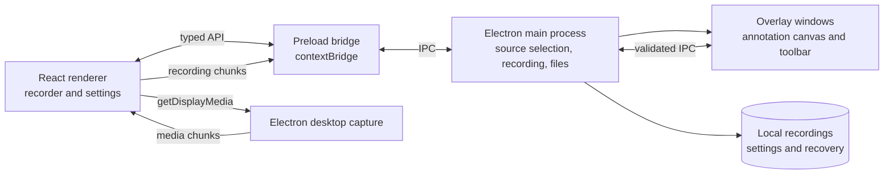

# Premium Recording

A lightweight desktop screen recorder for creating clear, annotated walkthroughs and product demos. Capture a display, a single window, or a selected screen region; add live annotations and cursor effects; record microphone audio with optional noise suppression; and save recordings locally.

> **Platform focus:** Windows desktop. Electron Builder configuration also includes macOS and Linux package targets, but the Windows workflow is the primary focus of the project.

## Highlights

- **Flexible capture:** choose a screen or window, with region selection available in the recording workflow.
- **Recording controls:** configure resolution and frame rate, choose a microphone, and use a start countdown.
- **Live annotations:** draw, add arrows and shapes, place stamps or text, spotlight content, erase, and undo/redo from a dockable panel.
- **Cursor presentation:** optional pointer highlight, click ripple, and drawn pointer effects.
- **Microphone processing:** mute or monitor microphone level and enable optional RNNoise-based suppression. **System audio is not captured.**
- **Local file management:** choose a save folder, browse recent recordings, open their location, and recover interrupted `.part` files.
- **Global shortcuts:** start/stop, pause/resume, toggle annotation interaction, and save an annotated screenshot.

## Technical architecture

The application uses Electron's main process for privileged desktop operations, a React renderer for the user interface, and a narrow preload bridge for communication between them.



### Runtime flow

1. The renderer requests available screens or windows through the preload API. The main process queries Electron's `desktopCapturer` and returns display metadata and thumbnails.
2. When recording starts, the main process validates the selected source and creates a uniquely named temporary `.part` file. The renderer obtains the selected display stream and sends media chunks through the recording IPC API.
3. The main process writes chunks to disk. The annotation canvas and toolbar run in separate overlay windows; the main process routes drawing commands, cursor updates, and microphone controls between the windows.
4. On stop, the stream is finalized to a unique output filename. If saving fails, the partial file is retained for recovery; abandoned partial recordings can be listed and recovered on a later launch.

### Process responsibilities

| Area | Responsibility |
| --- | --- |
| `src/main/` | App lifecycle, capture source handling, IPC handlers, file writing, settings, shortcuts, diagnostics, and overlay window management. |
| `src/preload/` | Exposes a deliberately limited, typed `window.api` interface to renderer windows. |
| `src/renderer/` | React UI for capture setup, settings, recording, annotation tools, recent files, and recovery. |
| `src/shared/` | IPC channel names, Zod request/response schemas, shortcut helpers, source identifiers, and media/container utilities. |

## Security and reliability

- Renderer windows enable **context isolation** and **sandboxing**, with Node integration disabled.
- Renderer-to-main operations go through the preload API; IPC inputs and outputs are checked with shared Zod schemas.
- Main-process handlers verify that requests originate from the app's own renderer and enforce sender-specific permissions for overlay operations.
- Recording data is written incrementally to `.part` files and finalized without overwriting existing recordings. Recoverable partial files are retained after save failures.
- The app uses a single-instance lock to avoid concurrent access to an active recording or save workflow.

## Supported capture and current limitations

- **Sources:** screens, individual windows, and a selected screen region.
- **Frame rates:** 24, 30, and 60 FPS (as documented in the app README).
- **Audio:** microphone input only; system audio capture is not supported.
- **Updates:** no automatic updater; the application does not check for or download releases.
- **Windows signing:** the installer is currently unsigned, so Windows SmartScreen may show a warning.
- **Platform validation:** automated tests cover logic; capture, installer, and playback behavior require manual testing on real Windows machines. The manual QA checklist currently marks its checks as not yet run.

## Getting started

### Prerequisites

- Git
- Node.js and npm compatible with the versions of Electron and Vite in `package.json`
- Windows for the primary development and capture workflow

### Install dependencies

```bash
git clone https://github.com/ashutoshshrimishra-cmyk/premium-recording.git
cd premium-recording
npm install
```

### Run in development

```bash
npm run dev
```

### Build and package

```bash
# Type-check and build the application
npm run build

# Build platform packages
npm run build:win
npm run build:mac
npm run build:linux
```

The Windows target uses Electron Builder and NSIS. Packaging targets for other operating systems are configured, but verify the app on the target OS before distributing it.

## Quality checks

```bash
npm test                 # Run Vitest tests
npm run typecheck        # Type-check Node/Electron and web/renderer code
npm run lint             # Run ESLint
npm run build            # Type-check and compile production assets
```

Tests live in `tests/` and cover focused logic such as annotation models, recording state, recovery, shortcuts, source IDs, audio helpers, and window/layout policies. For Windows capture, DPI, microphone, playback, and installer checks, follow [`docs/WINDOWS_QA.md`](docs/WINDOWS_QA.md).

## Project structure

```text
.
├── build/                  # Icons and packaging resources
├── docs/
│   └── WINDOWS_QA.md       # Manual Windows validation checklist
├── resources/              # Runtime application assets
├── scripts/                # Project utility scripts
├── src/
│   ├── main/               # Electron main process and native desktop integration
│   │   ├── ipc/            # IPC handlers and request authorization
│   │   ├── shortcuts/      # Global shortcut registration
│   │   └── windows/        # Annotation overlays, layout, and platform policies
│   ├── preload/            # Secure renderer API bridge
│   ├── renderer/           # React application and overlay views
│   └── shared/             # IPC contracts, validation schemas, and utilities
└── tests/                  # Vitest unit tests
```

## Useful npm scripts

| Command | Purpose |
| --- | --- |
| `npm run dev` | Start the Electron application in development mode. |
| `npm start` | Preview the built application. |
| `npm test` | Run the Vitest suite once. |
| `npm run typecheck` | Type-check Electron and renderer projects. |
| `npm run lint` | Run ESLint. |
| `npm run build` | Type-check and build production assets. |
| `npm run build:win` | Build and package for Windows. |
| `npm run build:mac` | Build and package for macOS. |
| `npm run build:linux` | Build and package for Linux. |

## Contributing

Contributions are welcome. For changes affecting capture, overlays, audio, recovery, or packaging, include focused tests where practical and update the Windows QA checklist when manual verification is needed. Please report platform-specific behavior with OS version, display/DPI setup, and relevant log details.

## License

This project is released under the [MIT License](LICENSE).
